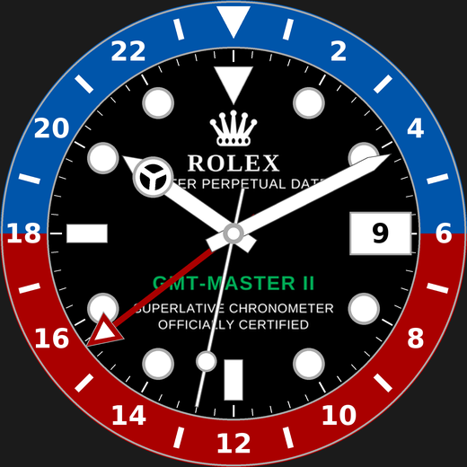

# GMT 24H – urskive for Garmin fenix 7

Privat hommage til Rolex GMT-Master II (ikke tilknyttet Rolex; kun til personlig bruk – ikke for Connect IQ Store). Urskiven har tofarget 24t-bezel, «Mercedes»-timeviser, GMT-viser med pil, lume-prikker og datovindu kl. 3.

## Installer (sideload)
1. Last ned `dist/GMT24H-fenix7.prg` (eller riktig modell: `fenix7s`, `fenix7x`, `fenix7pro` …).
2. Koble klokken til PC/Mac med USB-kabel (Mac: bruk *Android File Transfer* / *OpenMTP*).
3. Kopier `.prg`-filen til mappen **`GARMIN/APPS`** på klokken.
4. Koble fra. Velg urskiven: hold **UP** › *Urskive* › **GMT 24H**.

## Innstillinger (på klokken)
Hold **UP** på urskiven › *Urskive* › *Tilpass*:
- **Bezel**: Pepsi · Pepsi omvendt · Batman · Coke · Sprite
- **GMT +1 / −1 time**: tidssone for GMT-viseren (standard UTC)

## Bygg selv
Logo/skrift på skiven genereres av `tools/brand_assets.py` (en bitmap per skjermstørrelse i `resources-round-*`).

GitHub Actions (`.github/workflows/build.yml`) bygger automatisk ved hver push og legger `.prg` i `dist/`.
Lokalt: VS Code + Monkey C-utvidelsen, eller `./build.sh developer_key.der` med Connect IQ SDK installert.
