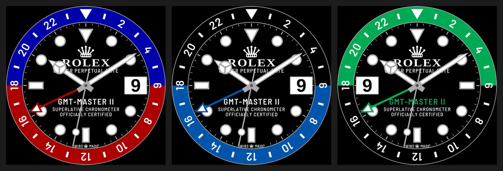
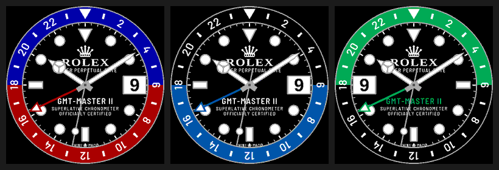

# GMT-Master II – urskive for Garmin fenix 7

Privat hommage til Rolex GMT-Master II (ikke tilknyttet Rolex; kun til personlig bruk – ikke for Connect IQ Store). Urskiven har tofarget 24t-bezel, «Mercedes»-timeviser, GMT-viser med pil, lume-prikker og datovindu kl. 3.

Slik ser den ut på fenix 7 (260 px, 64 farger):

## Installer (sideload)
1. Last ned `dist/GMT-Master-II-fenix7.prg` (eller riktig modell: `fenix7s`, `fenix7x`, `fenix7pro` …).
2. Koble klokken til PC/Mac med USB-kabel (Mac: bruk *Android File Transfer* / *OpenMTP*).
3. Kopier `.prg`-filen til mappen **`GARMIN/APPS`** på klokken.
4. Koble fra. Velg urskiven: hold **UP** › *Urskive* › **GMT-Master II**.

## Innstillinger (på klokken)
Hold **UP** på urskiven › *Urskive* › *Tilpass*:
- **Bezel**: Pepsi (blå/rød) · Batman (sort/blå) · Sprite (grønn/sort, dato kl. 9)
- **GMT +1 / −1 time**: tidssone for GMT-viseren (standard UTC)

## Bygg selv
Den statiske skiven (bezel, logo, skrift, indekser) og datotallene rendres av `tools/render_face.py` til bitmaps per variant og skjermstørrelse i `resources-round-*`. Fonter: Barlow (OFL) og Liberation.

GitHub Actions (`.github/workflows/build.yml`) bygger automatisk ved hver push og legger `.prg` i `dist/`.
Lokalt: VS Code + Monkey C-utvidelsen, eller `./build.sh developer_key.der` med Connect IQ SDK installert.
